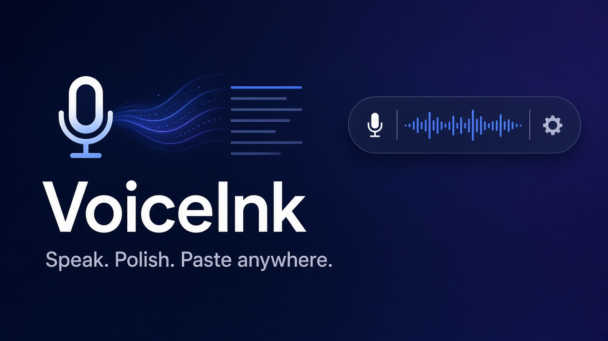
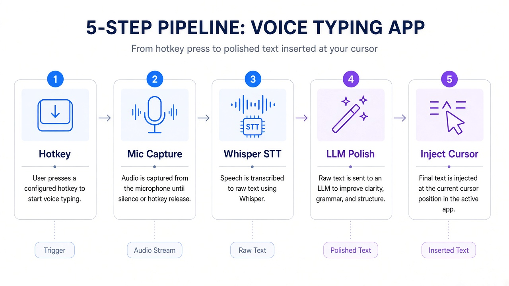
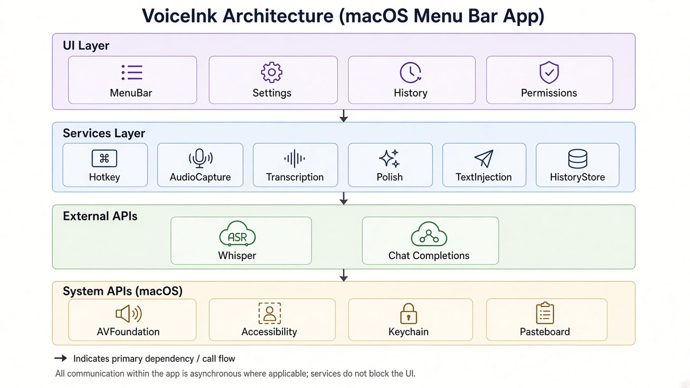

<p align="center">
  
</p>

<h1 align="center">VoiceInk</h1>

<p align="center">
  <strong>开源 AI 语音输入 macOS 菜单栏应用 —— 说话即打字，智能润色，无缝注入</strong>
</p>

<p align="center">
  <a href="#"></a>
  <a href="#"></a>
  <a href="LICENSE"></a>
  <a href="https://github.com/2023Anita/voiceink/stargazers"></a>
</p>

---

## 🎯 这是什么？

**VoiceInk** 是一个完全开源的 macOS 原生应用，让你用自然语音在任何应用中输入文字。它能：

- 🎙️ **按住热键说话** → 自动转录（Whisper AI）
- ✨ **智能润色** → 去除"嗯、啊、就是"等口语填充词，修正自我纠正，格式化列表
- ⚡ **即时注入** → 文字自动出现在你当前的输入框（Notes、TextEdit、浏览器等）

**这是一个独立的开源项目**，受 Typeless 等 AI 语音工具的启发，但完全从零实现。无品牌关联，MIT 开源，供学习和使用。

---

## 📸 演示与工作流程

### 录制演示 GIF 的方法
> **待添加**：使用 macOS 自带的屏幕录制（⌘⇧5），录制以下操作：
> 1. 点击菜单栏图标查看状态
> 2. 打开 Notes 或 TextEdit
> 3. 按住 Option+Space 组合键说话（菜单栏图标变化）
> 4. 释放键，等待 2-3 秒
> 5. 润色后的文字出现在文本框
> 
> 将 GIF 保存为 `docs/images/demo.gif` 并在此处引用。

### 工作流程

<p align="center">
  
</p>

**完整流程**：
1. **按下热键** → 开始录音（AVAudioRecorder）
2. **松开热键** → 停止录音，音频文件保存到临时目录
3. **语音转文字** → 上传到 OpenAI Whisper API（或兼容端点）
4. **AI 润色** → GPT-4o-mini 清理填充词、修正错误、格式化
5. **文本注入** → 保存剪贴板 → 模拟 Cmd+V → 恢复剪贴板
6. **保存历史** → SQLite 本地存储（原始文本 + 润色文本）

---

## ✨ 核心功能

### 📢 Typeless 风格的核心能力（开源实现）

| 功能 | 说明 | 状态 |
|------|------|------|
| 🎤 **全局热键录音** | 默认 Option+Space 组合键，可自定义任意组合键 | ✅ |
| 🎯 **智能文本润色** | 移除填充词（um, uh, you know），修正自我纠正 | ✅ |
| 📝 **列表格式化** | 自动识别"第一、第二"并格式化为列表 | ✅ |
| 💬 **语气预设** | 中性 / 邮件 / 聊天风格 | ✅ |
| 🔄 **通用应用注入** | 支持 Notes、TextEdit、浏览器、Slack 等任意文本框 | ✅ |
| 📦 **本地历史记录** | SQLite 存储，可查看/复制/删除历史记录 | ✅ |
| 🔒 **安全凭证管理** | API 密钥存储在 macOS 钥匙串（加密） | ✅ |
| 🧪 **测试模式** | 无需 API 密钥的 Stub 模式，快速体验 | ✅ |

### 🚫 明确声明

**VoiceInk 不是 Typeless 的克隆或分支**。这是一个独立的开源项目，旨在：
- 学习和实践 macOS 原生开发（SwiftUI + AppKit）
- 演示 AI 语音工具的底层实现原理
- 为开源社区提供可自托管的替代方案

如果你需要商业级功能（实时流式转录、团队协作、云同步），请使用官方产品。

---

## 🏗️ 架构设计

### 系统架构图

<p align="center">
  
</p>

### 数据流 Mermaid 图


### 代码模块

```
VoiceInk/
├── VoiceInkApp.swift              # 应用入口 + NSStatusItem
├── MenuBarController.swift         # 菜单栏 UI + 热键监听
├── Services/
│   ├── RecordingPipeline.swift    # 主流程编排器
│   ├── AudioCaptureService.swift  # AVAudioRecorder 封装
│   ├── TranscriptionService.swift # Whisper API + Stub 实现
│   ├── PolishService.swift        # GPT 润色 + Passthrough
│   ├── TextInjectionService.swift # 剪贴板 + Accessibility 注入
│   ├── HistoryStore.swift         # SQLite (GRDB) 历史存储
│   ├── SettingsStore.swift        # UserDefaults + Keychain
│   └── PermissionManager.swift    # 麦克风 + 辅助功能权限
└── UI/
    ├── HistoryWindow.swift        # 历史记录浏览器
    ├── SettingsWindow.swift       # 设置面板（API 密钥 + 热键）
    └── PermissionsWindow.swift    # 权限引导界面
```

**设计原则**：
- **协议导向**：每个服务都是协议，方便测试和替换（如 Stub 模式）
- **异步优先**：全部使用 Swift async/await，无回调地狱
- **关注点分离**：UI、业务逻辑、存储完全解耦
- **类型安全**：利用 Swift 强类型系统避免运行时错误

---

## 🛠️ 这个项目是如何构建的

### 第一步：产品拆解
我们研究了 Typeless、Talon Voice 等公开的语音输入工具，总结了核心用户价值：
1. **零打断**：不需要切换应用，直接在当前位置输入
2. **自然语言**：说话时可以有"嗯啊"，可以自我纠正
3. **即时可用**：不需要训练模型或适配期

### 第二步：MVP 范围界定
参考 [SPEC_1ca8.md](uploads/SPEC_1ca8.md)，我们明确了 MVP 必须有和不必有的功能：

**必须有**：
- 全局热键 + 录音
- Whisper 转录
- GPT 润色（可关闭）
- 文本注入（剪贴板方案）
- 菜单栏 UI
- 本地历史

**Phase 2（未实现）**：
- 实时流式转录
- 选中文本重新转录（Speak-to-edit）
- Ask Anything 面板
- 个人词典
- 云同步

### 第三步：SwiftUI 菜单栏设计
macOS 菜单栏应用需要：
- `NSApplicationDelegate` 设置 `.accessory` 模式（无 Dock 图标）
- `NSStatusItem` 在菜单栏显示图标
- `NSMenu` 构建菜单项
- SwiftUI 的 `NSHostingView` 嵌入现代 UI 组件

关键代码模式：
```swift
// 菜单栏应用入口
@main
struct VoiceInkApp: App {
    @NSApplicationDelegateAdaptor(AppDelegate.self) var appDelegate
    var body: some Scene { Settings { EmptyView() } }
}

// 设置为后台应用
NSApp.setActivationPolicy(.accessory)

// 创建状态栏图标
statusItem = NSStatusBar.system.statusItem(withLength: .variableLength)
statusItem?.button?.image = NSImage(systemSymbolName: "mic.circle", ...)
```

### 第四步：服务协议设计
所有核心服务都基于协议，这样可以：
- 单元测试时 mock 实现
- 提供 Stub 模式（无 API 密钥测试）
- 未来支持其他 STT/LLM 提供商

示例：
```swift
protocol TranscriptionService {
    func transcribe(audioURL: URL) async throws -> String
}

class WhisperTranscriptionService: TranscriptionService { ... }
class StubTranscriptionService: TranscriptionService { ... }
```

### 第五步：Stub 模式实现
在设置中启用"Stub 模式"后：
- 转录返回固定的测试文本（包含填充词）
- 润色正常工作（可测试 GPT 集成）
- 整个流程可在没有 OpenAI 账号的情况下演示

### 第六步：权限处理
macOS 需要两个关键权限：
1. **麦克风**：`AVCaptureDevice.requestAccess(for: .audio)`
2. **辅助功能**：`AXIsProcessTrusted()` + 系统设置引导

我们提供了完整的权限引导界面，逐步指导用户授权。

---

## 🚀 快速开始

### 系统要求
- macOS 13.0 (Ventura) 或更高版本
- Xcode 15.0 或更高版本
- 约 2 GB 可用磁盘空间

### 一、克隆项目

```bash
git clone https://github.com/2023Anita/voiceink.git
cd voiceink
```

### 二、打开项目

```bash
open Package.swift
```

Xcode 会自动：
- 解析依赖（KeyboardShortcuts、GRDB）
- 配置构建方案

### 三、构建并运行

在 Xcode 中按 **⌘R**（或 Product → Run）

首次构建需要 2-3 分钟编译依赖。

### 四、授予权限

应用启动后：

1. **麦克风权限**：
   - 自动弹出授权对话框
   - 点击"确定"允许

2. **辅助功能权限**：
   - 菜单栏图标 → **Permissions** → **Grant Access**
   - 跳转到 System Settings → Privacy & Security → Accessibility
   - 找到 VoiceInk 并勾选启用
   - 返回应用点击"Check Status"确认

### 五、配置（二选一）

#### 选项 A：使用 Stub 模式（无需 API 密钥）

1. 点击菜单栏图标 → **Settings** → **General**
2. 启用 **"Use Stub Mode"**
3. 完成！可以测试整个流程（转录会返回假文本）

#### 选项 B：使用真实转录（推荐）

1. 获取 OpenAI API 密钥：[platform.openai.com/api-keys](https://platform.openai.com/api-keys)
2. 菜单栏图标 → **Settings** → **API Keys**
3. 粘贴密钥并点击 **Save**（存储在钥匙串中）
4. 在 **General** 设置中**关闭** "Use Stub Mode"

### 六、开始使用

1. 打开任意文本应用（Notes、TextEdit、浏览器）
2. 点击文本框，确保光标闪烁
3. **按住 Option+Space 组合键** (⌥Space)
4. 自然说话："你好世界，这是一个测试"
5. **松开键**
6. 等待 2-3 秒
7. 看到润色后的文字出现！

---

## ⚙️ 配置选项

### 热键设置
| 设置项 | 默认值 | 说明 |
|--------|--------|------|
| 录音热键 | Option+Space (⌥Space) | 可在 Settings → Hotkey 中自定义为任意组合键 |

### API 设置
| 环境变量 | 默认值 | 说明 |
|----------|--------|------|
| `OPENAI_API_BASE` | `https://api.openai.com/v1` | 自定义端点（支持兼容 OpenAI 格式的服务） |
| `VOICEINK_STT_MODEL` | `whisper-1` | 语音转文字模型名 |
| `VOICEINK_POLISH_MODEL` | `gpt-4o-mini` | 润色用的 Chat 模型名 |

环境变量可在 Xcode 中设置：Product → Scheme → Edit Scheme → Run → Arguments → Environment Variables。API 密钥不走环境变量，只存钥匙串。

### 文本润色
| 设置项 | 选项 | 说明 |
|--------|------|------|
| 启用润色 | ON / OFF | 关闭后直接注入原始转录 |
| 语气 | Neutral / Email / Chat | 影响润色后的语言风格 |
| 语言 | 自动检测 / en / zh / es / fr | 指定转录语言（可选） |

### Stub 模式
开启 Stub 模式后完全离线：转录返回固定示例文本，润色使用本地规则（去除 um/uh/you know 和重复词），不调用任何 API。

### ⚠️ 构建注意事项
- 本项目在 Linux 环境中编写，**尚未在真实 Mac 上编译验证**；首次构建如遇编译错误，欢迎提 Issue/PR。
- 通过 `Package.swift` 运行时是 SwiftPM 可执行文件而非 `.app`，`Info.plist` 不会被打包；首次访问麦克风时 macOS 可能不弹授权框。若遇到此问题，请在 Xcode 中新建 macOS App target 引入 `Sources/` 并使用仓库中的 `Info.plist`。
- 辅助功能权限按可执行文件路径授予，重新构建后可能需要在系统设置中重新勾选。

---

## 🐛 故障排除

### 问题：热键无响应
**解决方案**：
1. 确认辅助功能权限已授予（System Settings → Privacy & Security → Accessibility → VoiceInk ✓）
2. 检查是否有其他应用占用同一热键
3. 尝试在 Settings → Hotkey 中更换为 F13 或 Caps Lock

### 问题：录音后无文字出现
**排查步骤**：
1. 打开 History 窗口，查看是否有记录（判断是转录失败还是注入失败）
2. 如果有历史记录：
   - 检查文本框是否**真的获得焦点**（光标是否闪烁）
   - 尝试手动点击文本框后再使用热键
3. 如果没有历史记录：
   - 检查麦克风权限
   - 查看 Xcode Console 中的错误日志
   - 确认 API 密钥正确（或启用 Stub 模式测试）

### 问题：API 错误
**常见原因**：
- API 密钥无效或过期
- OpenAI 账号余额不足
- 网络连接问题

**解决方案**：
1. 检查 [platform.openai.com/api-keys](https://platform.openai.com/api-keys) 确认密钥有效
2. 检查账单页面确认有余额
3. 先用 Stub 模式测试，排除其他问题

### 问题：文字注入到错误位置
**解决方案**：
- 确保目标文本框**已聚焦**（点击后光标闪烁）
- 某些应用（如 Final Cut Pro）不支持剪贴板粘贴，VoiceInk 会自动回退到逐字符输入（较慢但兼容）

### 问题：构建失败
**解决方案**：
```bash
# 清理并重新解析依赖
rm Package.resolved
rm -rf .build
swift package resolve
```

或在 Xcode 中：
- Product → Clean Build Folder (⌘⇧K)
- File → Packages → Reset Package Caches

---

## 🗺️ 路线图

### Phase 2（未实现，欢迎贡献）
- [ ] **Speak-to-edit**：选中文本后按热键，重新口述覆盖
- [ ] **Ask Anything**：专用面板，语音提问 + 搜索 + AI 回答
- [ ] **实时流式转录**：说话时即时显示部分文本
- [ ] **个人词典**：自定义缩写、专业术语替换
- [ ] **翻译模式**：用中文说话 → 输出英文
- [ ] **每应用配置**：不同应用自动切换语气（Slack 用聊天风格，邮件用正式风格）
- [ ] **云同步**：可选的历史记录同步（需自建后端）

### 社区需求
- [ ] 支持本地 Whisper 模型（避免 API 调用）
- [ ] 支持其他 LLM（Claude、Gemini、本地 Ollama）
- [ ] Windows / Linux 版本（考虑 Tauri 跨平台）

---

## 📜 许可证与免责声明

### MIT 许可证
本项目采用 MIT 许可证，详见 [LICENSE](LICENSE) 文件。

您可以自由地：
- ✅ 商业使用
- ✅ 修改和分发
- ✅ 私有使用
- ✅ 专利使用

### 免责声明

1. **非官方项目**：
   - VoiceInk 与 Typeless、Talon Voice 或任何商业语音输入产品**无关联、无授权、无背书**
   - 这是一个独立的开源项目，用于学习和研究

2. **隐私说明**：
   - 录音文件临时存储在 `/tmp`，处理后立即删除
   - 历史记录存储在本地 SQLite（`~/Library/Application Support/VoiceInk/`）
   - API 密钥存储在 macOS 钥匙串（系统级加密）
   - **音频数据会发送到 OpenAI API**（如使用真实转录）
   - 无遥测，无数据上传到第三方（除 OpenAI API）

3. **安全提示**：
   - 请勿在包含敏感信息的环境中使用（除非自托管 Whisper）
   - API 密钥泄露风险由用户自行承担
   - 建议使用限额 API 密钥

4. **不保证**：
   - 本软件按"原样"提供，无任何明示或暗示的保证
   - 作者不对使用本软件造成的任何损失负责

---

## 🤝 贡献指南

欢迎贡献！请遵循以下步骤：

1. Fork 本仓库
2. 创建特性分支 (`git checkout -b feature/amazing-feature`)
3. 提交更改 (`git commit -m 'Add amazing feature'`)
4. 推送到分支 (`git push origin feature/amazing-feature`)
5. 开启 Pull Request

**代码规范**：
- 遵循 Swift 官方风格指南
- 为新功能添加单元测试
- 更新相关文档

---

## 📚 相关资源

- [OpenAI Whisper API](https://platform.openai.com/docs/guides/speech-to-text)
- [OpenAI Chat Completions API](https://platform.openai.com/docs/guides/chat)
- [KeyboardShortcuts 库](https://github.com/sindresorhus/KeyboardShortcuts)
- [GRDB.swift 文档](https://github.com/groue/GRDB.swift)
- [SwiftUI 官方教程](https://developer.apple.com/tutorials/swiftui)

---

## 🙏 致谢

感谢以下开源项目和技术：
- **KeyboardShortcuts** by [Sindre Sorhus](https://github.com/sindresorhus)
- **GRDB.swift** by [Gwendal Roué](https://github.com/groue)
- **OpenAI Whisper & GPT** for powerful AI capabilities
- 所有贡献者和测试者

---

## 📬 联系方式

- GitHub Issues: [报告问题](https://github.com/2023Anita/voiceink/issues)
- Discussions: [功能讨论](https://github.com/2023Anita/voiceink/discussions)

---

<p align="center">
  <strong>VoiceInk</strong> - 让你的声音成为文字 🎙️✨
</p>

<p align="center">
  如果这个项目对你有帮助，请给个 ⭐ Star 支持一下！
</p>

---

# English Documentation

<details>
<summary><strong>Click to expand English version</strong></summary>

## What is VoiceInk?

**VoiceInk** is a fully open-source native macOS application that lets you input text naturally with your voice in any application. 

**Core capabilities:**
- 🎙️ **Press hotkey and speak** → Auto-transcribed (Whisper AI)
- ✨ **Smart polish** → Remove filler words (um, uh, you know), honor self-corrections, format lists
- ⚡ **Instant injection** → Text automatically appears in your current input field (Notes, TextEdit, browsers, etc.)

**This is an independent open-source project**, inspired by tools like Typeless, but built from scratch. No brand affiliation, MIT licensed, for learning and use.

## Quick Start

### Requirements
- macOS 13.0 (Ventura) or later
- Xcode 15.0 or later

### Installation

```bash
git clone https://github.com/2023Anita/voiceink.git
cd voiceink
open Package.swift
```

Press **⌘R** in Xcode to build and run.

### Configuration

**Option A: Stub Mode (No API Key)**
1. Menu bar icon → Settings → General
2. Enable "Use Stub Mode"

**Option B: Real Transcription**
1. Get OpenAI API key from [platform.openai.com/api-keys](https://platform.openai.com/api-keys)
2. Menu bar icon → Settings → API Keys
3. Paste and Save

### Usage

1. Open Notes or any text field
2. **Press and hold Option+Space** (⌥Space)
3. Speak naturally
4. **Release** the key
5. Polished text appears!

## Architecture

```
Hotkey → Audio Capture → Whisper STT → GPT Polish → Inject → History
```

Built with:
- SwiftUI + AppKit (native macOS)
- Protocol-oriented services
- Async/await concurrency
- Secure Keychain storage

## Features

✅ Global hotkey (configurable)  
✅ Whisper transcription  
✅ GPT-4o-mini text polishing  
✅ Universal app injection (clipboard + Accessibility)  
✅ Local SQLite history  
✅ Stub mode (no API key needed)  
✅ Microphone + Accessibility permission guide  

## Roadmap

- [ ] Speak-to-edit (re-dictate selected text)
- [ ] Ask Anything panel
- [ ] Real-time streaming transcription
- [ ] Personal dictionary
- [ ] Translation mode
- [ ] Per-app tone profiles

## License

MIT License - see [LICENSE](LICENSE) file.

**Disclaimer:** This project is not affiliated with or endorsed by Typeless or any commercial voice input product. Audio data is sent to OpenAI API if using real transcription.

## Contributing

Contributions welcome! Please:
1. Fork the repo
2. Create a feature branch
3. Submit a Pull Request

---

**VoiceInk** - Turn your voice into text 🎙️✨

</details>
